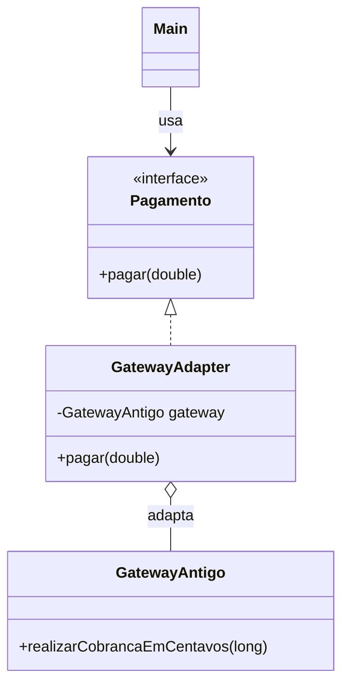

# Adapter

## Intenção e exemplo

Adapter é um padrão estrutural que converte a interface de uma classe em outra interface esperada pelo cliente. Ele permite integrar classes incompatíveis sem alterar seu código original.

No exemplo, a aplicação espera `Pagamento.pagar(double)`, enquanto `GatewayAntigo` recebe centavos. `GatewayAdapter` traduz tanto a chamada quanto a unidade do valor.

## Características

- fica entre o cliente e um objeto com interface incompatível;
- traduz chamadas, tipos, formatos ou unidades;
- preserva o contrato esperado pelo restante da aplicação;
- pode ser implementado por composição (adapter de objeto) ou herança (adapter de classe).

## Recursos de POO utilizados

- **Interface e abstração:** `Pagamento` representa o contrato que o cliente conhece.
- **Composição:** o adapter mantém uma referência para `GatewayAntigo`.
- **Delegação:** depois da conversão, o adapter delega o trabalho ao objeto adaptado.
- **Polimorfismo:** o cliente usa `Pagamento` sem distinguir uma implementação nativa de um adapter.
- **Encapsulamento:** detalhes do legado e da conversão ficam isolados.

## Vantagens

- reutiliza código legado ou de terceiros;
- evita mudanças em classes estáveis;
- concentra a lógica de conversão;
- reduz o acoplamento do cliente com APIs externas.

## Desvantagens

- adiciona uma camada e novas classes;
- muitos adapters podem tornar a arquitetura mais difícil de navegar;
- conversões complexas podem esconder diferenças semânticas importantes.

## Diagrama de classes



## Executar

```bash
javac -d out src/Main.java
java -cp out Main
```
