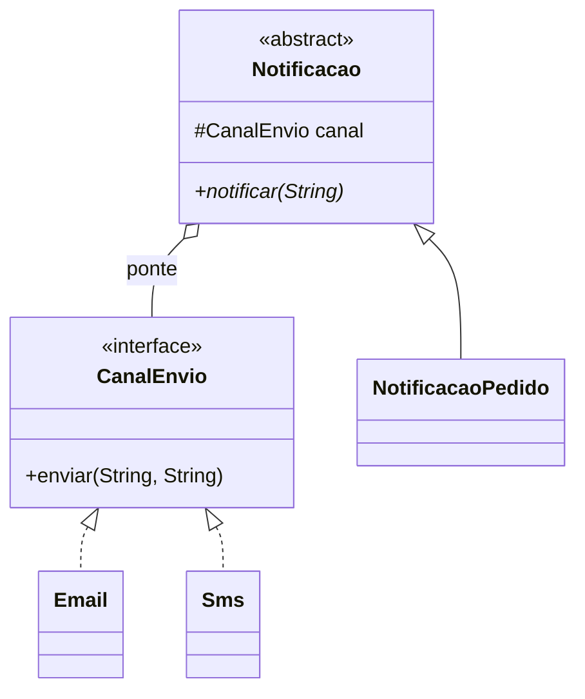

# Bridge

## Intenção e exemplo

Bridge é um padrão estrutural que separa uma abstração de sua implementação para que as duas hierarquias possam variar independentemente.

No exemplo há duas dimensões: o tipo da notificação e o canal de envio. `Notificacao` mantém uma ponte para `CanalEnvio`; assim, não é necessário criar classes como `NotificacaoPedidoPorEmail` e `NotificacaoPedidoPorSms`.

## Características

- divide uma classe com várias dimensões de variação em duas hierarquias;
- conecta essas hierarquias por composição;
- a abstração contém regras de alto nível;
- a implementação contém os detalhes específicos da plataforma ou mecanismo.

## Recursos de POO utilizados

- **Abstração:** `Notificacao` representa o conceito de alto nível e `CanalEnvio`, a implementação.
- **Composição:** a notificação possui um canal em vez de herdar dele.
- **Delegação:** a abstração delega o envio ao canal configurado.
- **Herança:** novos tipos de notificação especializam `Notificacao`.
- **Polimorfismo:** qualquer `CanalEnvio` pode ocupar a ponte em tempo de execução.

## Vantagens

- evita a multiplicação de subclasses para cada combinação;
- permite trocar implementações em tempo de execução;
- facilita evoluir as duas hierarquias separadamente;
- favorece composição em vez de herança excessiva.

## Desvantagens

- aumenta a quantidade inicial de abstrações;
- pode ser complexo demais quando existe apenas uma dimensão estável;
- exige identificar corretamente quais responsabilidades devem variar separadamente.

## Diagrama de classes



## Executar

```bash
javac -d out src/Main.java
java -cp out Main
```
