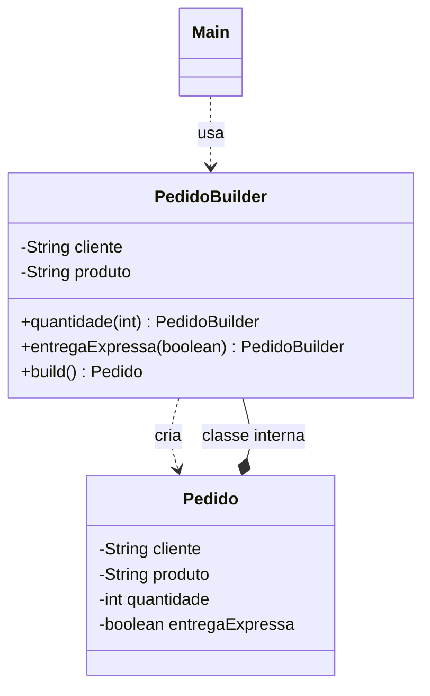

# Builder

## Intenção e exemplo

Builder é um padrão criacional que constrói um objeto complexo passo a passo. Ele evita construtores com muitos parâmetros e permite que atributos opcionais sejam informados de modo legível.

No exemplo, `Pedido.Builder` recebe os dados obrigatórios (`cliente` e `produto`) e oferece métodos encadeáveis para os dados opcionais. `build()` cria um `Pedido` imutável.

## Características

- separa o processo de construção do objeto final;
- permite configurar somente as partes necessárias;
- favorece uma API fluente, na qual cada etapa retorna o próprio builder;
- pode validar os dados antes de entregar o objeto pronto.

## Recursos de POO utilizados

- **Encapsulamento:** o construtor de `Pedido` é privado e seus atributos não podem ser alterados externamente.
- **Composição:** o objeto final é montado a partir do estado mantido pelo `Builder`.
- **Abstração:** quem usa a classe conhece as etapas de construção, mas não precisa conhecer os detalhes do construtor.
- **Imutabilidade:** os atributos `final` garantem que o pedido pronto não mude (é uma prática complementar ao padrão).
- **Sobrecarga evitada:** em vez de vários construtores, os métodos nomeados expressam cada opção.

## Vantagens

- torna a criação de objetos com muitos parâmetros mais legível;
- evita a explosão de construtores sobrecarregados;
- centraliza validações;
- permite criar objetos imutáveis.

## Desvantagens

- adiciona uma classe e código de apoio;
- pode ser exagero para objetos com poucos campos;
- o builder precisa acompanhar mudanças feitas no produto.

## Diagrama de classes



## Executar

```bash
javac -d out src/Main.java
java -cp out Main
```
