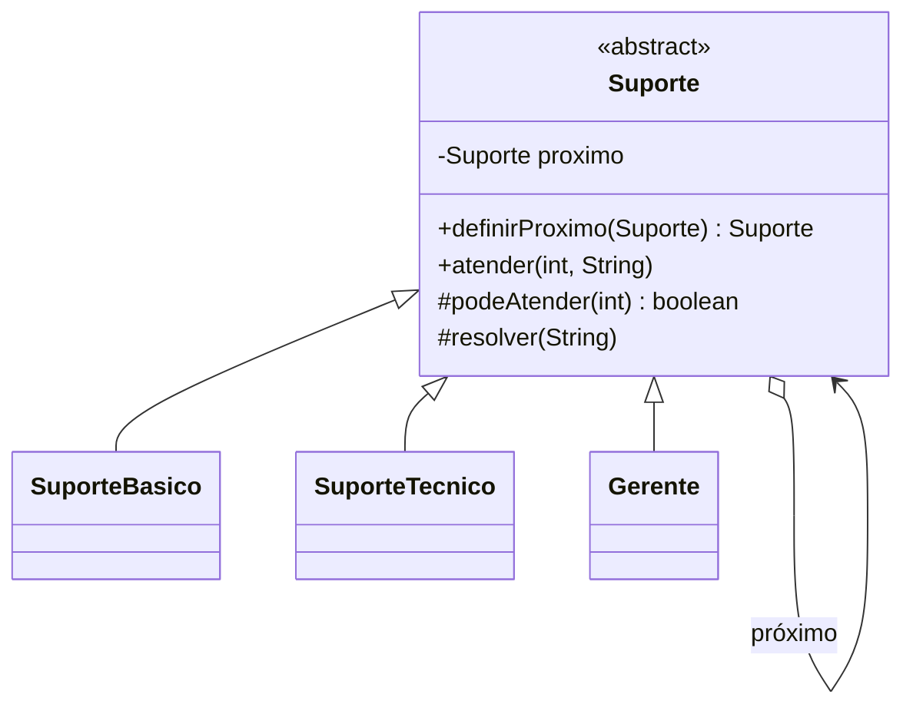

# Chain of Responsibility

## Intenção e exemplo

Chain of Responsibility é um padrão comportamental que passa uma solicitação por uma cadeia de tratadores. Cada tratador decide se resolve a solicitação ou se a encaminha ao próximo.

No exemplo, chamados percorrem suporte básico, suporte técnico e gerente conforme o nível exigido. O emissor conhece apenas o primeiro elo.

## Características

- tratadores são ligados em sequência;
- cada elo possui a mesma interface de atendimento;
- um elo pode processar ou encaminhar a solicitação;
- a ordem e a composição da cadeia podem ser configuradas em tempo de execução.

## Recursos de POO utilizados

- **Abstração:** `Suporte` define o protocolo comum dos tratadores.
- **Herança:** os níveis concretos especializam as decisões e ações.
- **Polimorfismo:** cada elo responde a `podeAtender()` e `resolver()` de forma própria.
- **Associação recursiva:** um `Suporte` mantém uma referência para outro `Suporte`.
- **Delegação:** solicitações não atendidas são repassadas ao próximo objeto.
- **Template Method auxiliar:** `atender()` fixa o fluxo e chama operações sobrescritas.

## Vantagens

- desacopla o emissor de quem efetivamente atende;
- permite reorganizar ou estender a cadeia;
- distribui responsabilidades em classes pequenas;
- evita grandes blocos condicionais centralizados.

## Desvantagens

- uma solicitação pode terminar sem atendimento;
- a ordem incorreta pode produzir comportamento inesperado;
- depuração é mais difícil porque a chamada percorre vários objetos;
- cadeias longas aumentam o custo de processamento.

## Diagrama de classes



## Executar

```bash
javac -d out src/Main.java
java -cp out Main
```
