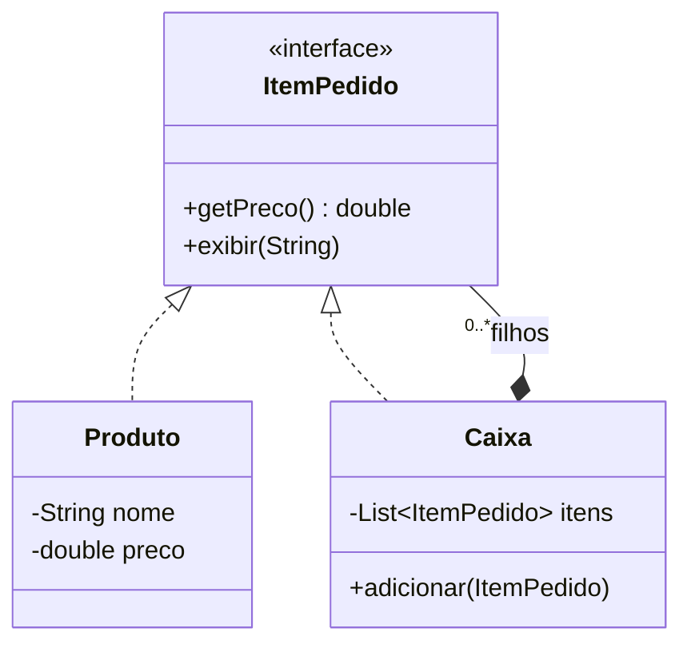

# Composite

## Intenção e exemplo

Composite é um padrão estrutural que organiza objetos em uma árvore e permite tratar objetos individuais e composições de maneira uniforme.

No exemplo, tanto um `Produto` (folha) quanto uma `Caixa` (composto) implementam `ItemPedido`. Uma caixa pode conter produtos ou outras caixas, e seu preço é a soma recursiva dos filhos.

## Características

- representa hierarquias parte-todo;
- usa uma interface comum para folhas e compostos;
- o composto armazena uma coleção de componentes;
- operações percorrem a árvore recursivamente.

## Recursos de POO utilizados

- **Interface e abstração:** `ItemPedido` uniformiza folhas e compostos.
- **Polimorfismo:** o cliente chama `getPreco()` sem saber se o item é simples ou composto.
- **Composição recursiva:** `Caixa` contém objetos do mesmo tipo abstrato que ela implementa.
- **Delegação:** o composto delega a operação a cada filho e combina os resultados.
- **Encapsulamento:** a regra de cálculo da árvore fica dentro de `Caixa`.

## Vantagens

- simplifica o código cliente;
- representa árvores naturalmente;
- facilita adicionar novos tipos de folha ou composto;
- permite aplicar uma operação à estrutura inteira.

## Desvantagens

- uma interface comum pode ficar genérica demais;
- pode ser difícil restringir quais componentes um composto aceita;
- árvores muito profundas podem causar custo de percurso ou recursão;
- regras específicas de certos nós podem exigir verificações adicionais.

## Diagrama de classes



## Executar

```bash
javac -d out src/Main.java
java -cp out Main
```
