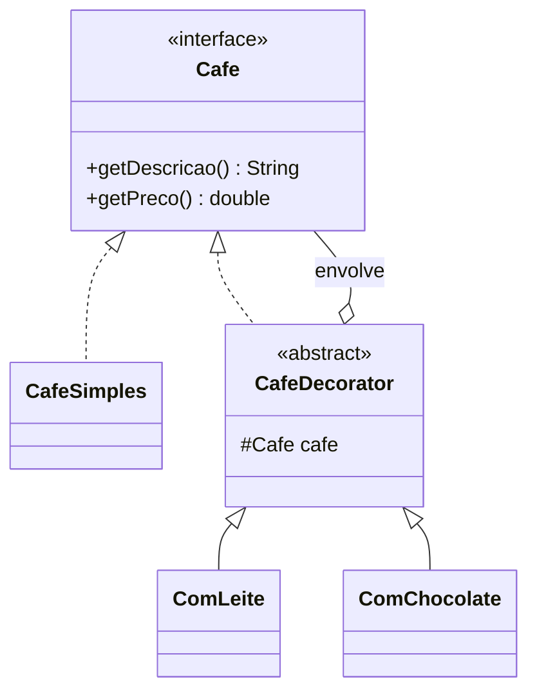

# Decorator

## Intenção e exemplo

Decorator é um padrão estrutural que acrescenta responsabilidades a um objeto dinamicamente ao envolvê-lo com objetos que preservam a mesma interface.

No exemplo, um `CafeSimples` é envolvido por `ComLeite` e depois por `ComChocolate`. Cada decorador delega ao café interno e adiciona descrição e preço próprios.

## Características

- componente e decoradores compartilham a mesma interface;
- cada decorador mantém uma referência para outro componente;
- decoradores podem ser combinados e empilhados;
- comportamento é adicionado a instâncias, não à classe inteira.

## Recursos de POO utilizados

- **Interface e polimorfismo:** todo objeto da cadeia pode ser usado como `Cafe`.
- **Composição:** cada decorador contém o componente que envolve.
- **Delegação:** o decorador chama o objeto interno antes de complementar o resultado.
- **Herança:** a classe abstrata `CafeDecorator` compartilha a estrutura dos decoradores concretos.
- **Encapsulamento:** cada responsabilidade adicional fica isolada em uma classe.

## Vantagens

- adiciona ou remove comportamentos em tempo de execução;
- evita muitas subclasses para representar combinações;
- permite combinar responsabilidades em ordens diferentes;
- favorece classes pequenas e focadas.

## Desvantagens

- cria muitos objetos pequenos;
- a ordem dos decoradores pode alterar o resultado;
- depuração pode ser mais difícil em cadeias longas;
- pode ser difícil remover um decorador específico do meio da cadeia.

## Diagrama de classes



## Executar

```bash
javac -d out src/Main.java
java -cp out Main
```
