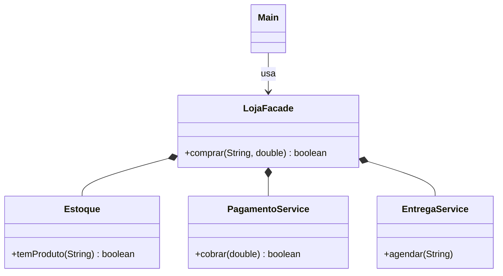

# Facade

## Intenção e exemplo

Facade é um padrão estrutural que oferece uma interface simplificada para um subsistema composto por várias classes.

No exemplo, uma compra exige consultar estoque, cobrar o pagamento e agendar a entrega. O cliente chama apenas `LojaFacade.comprar()`, e a fachada coordena os serviços na ordem correta.

## Características

- apresenta um ponto de entrada de alto nível;
- coordena várias operações internas;
- não impede o acesso direto ao subsistema quando ele for necessário;
- reduz o conhecimento que o cliente precisa ter sobre dependências internas.

## Recursos de POO utilizados

- **Encapsulamento:** a sequência e os detalhes da compra ficam escondidos na fachada.
- **Composição:** `LojaFacade` possui referências para os serviços do subsistema.
- **Delegação:** cada etapa é executada pelo objeto especializado correspondente.
- **Abstração:** `comprar()` representa uma operação de negócio de nível mais alto.
- **Baixo acoplamento:** o cliente depende de uma classe estável, não de todos os serviços.

## Vantagens

- simplifica o uso de subsistemas complexos;
- reduz acoplamento e conhecimento entre camadas;
- centraliza um fluxo comum;
- fornece um ponto útil para validação, registro e tratamento de erros.

## Desvantagens

- pode virar uma classe grande com responsabilidades demais;
- uma fachada excessivamente genérica pode esconder funções importantes;
- mudanças no subsistema ainda podem exigir mudanças na fachada;
- pode se tornar um ponto de acoplamento central se for mal dividida.

## Diagrama de classes



## Executar

```bash
javac -d out src/Main.java
java -cp out Main
```
