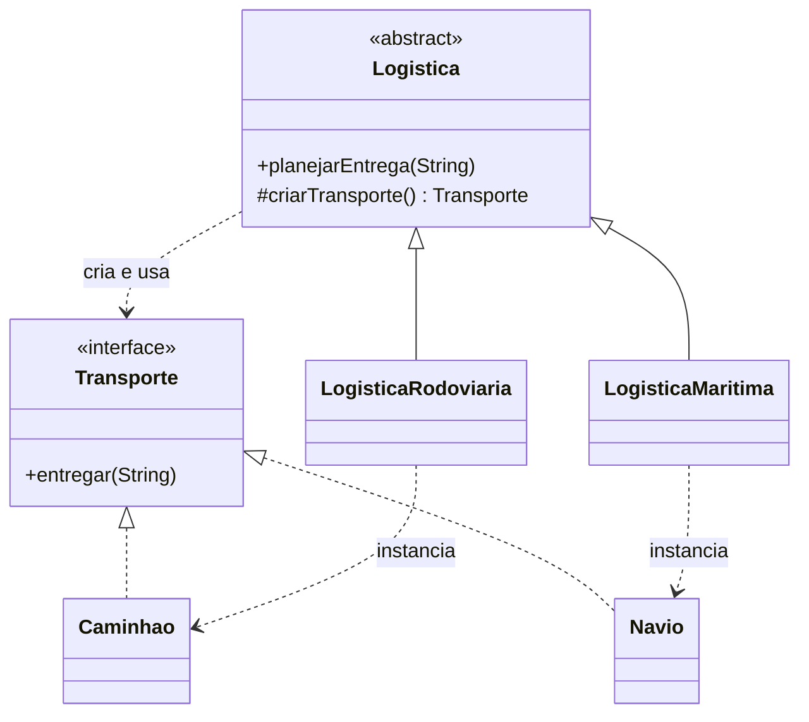

# Factory Method

## Intenção e exemplo

Factory Method é um padrão criacional que define um método para criar objetos, mas permite que subclasses decidam qual classe concreta será instanciada.

No exemplo, `Logistica` contém o fluxo comum da entrega. Suas subclasses sobrescrevem `criarTransporte()` para fornecer um `Caminhao` ou um `Navio`.

## Características

- a criação ocorre por meio de um método fábrica;
- o código principal trabalha com a abstração do produto;
- subclasses escolhem o produto concreto;
- criação e utilização do objeto ficam desacopladas.

## Recursos de POO utilizados

- **Herança:** `LogisticaRodoviaria` e `LogisticaMaritima` especializam `Logistica`.
- **Polimorfismo:** a chamada a `criarTransporte()` executa a versão da subclasse em tempo de execução.
- **Abstração:** `Transporte` define o contrato dos produtos, e `Logistica` define o fluxo dos criadores.
- **Encapsulamento da criação:** o cliente não chama diretamente os construtores de `Caminhao` e `Navio`.
- **Inversão de dependência:** o fluxo de entrega depende da interface `Transporte`, não dos produtos concretos.

## Vantagens

- reduz o acoplamento com classes concretas;
- facilita adicionar novos tipos de produto;
- centraliza a lógica de criação;
- respeita o princípio aberto/fechado no fluxo principal.

## Desvantagens

- normalmente exige uma nova subclasse de criador para cada produto;
- aumenta o número de classes;
- pode ser excessivo quando a criação é muito simples e nunca varia.

## Diagrama de classes



## Executar

```bash
javac -d out src/Main.java
java -cp out Main
```
