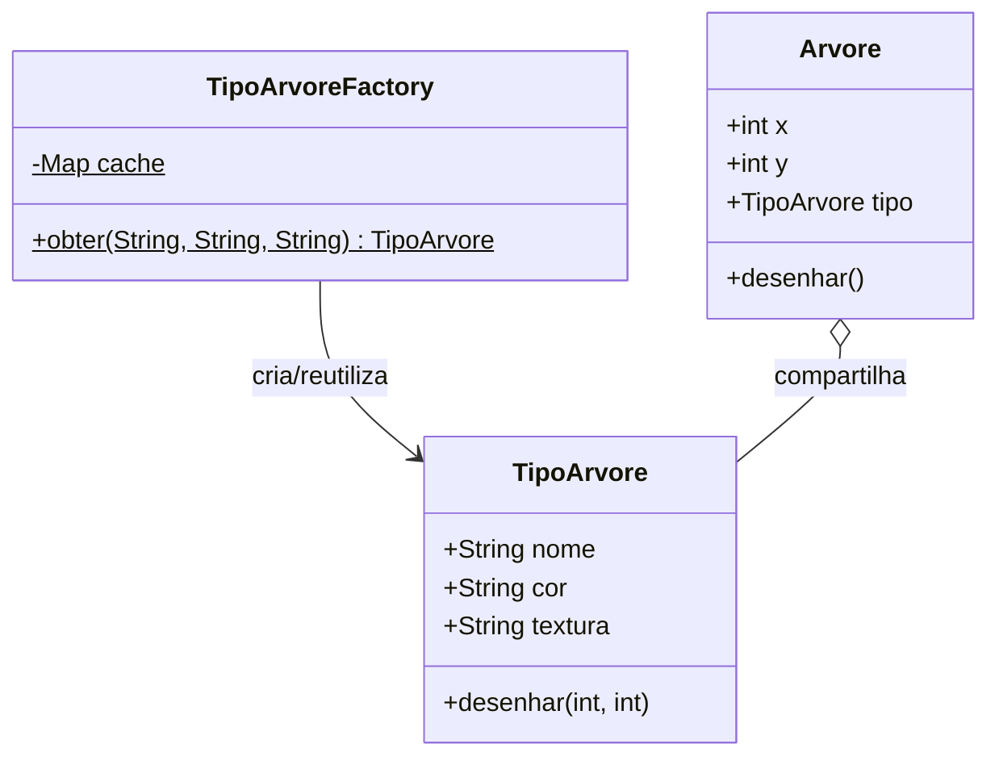

# Flyweight

## Intenção e exemplo

Flyweight é um padrão estrutural que economiza memória compartilhando o estado comum entre muitos objetos, em vez de repetir os mesmos dados em cada instância.

No exemplo, `TipoArvore` é o flyweight e guarda o estado intrínseco compartilhado (nome, cor e textura). `Arvore` guarda o estado extrínseco que varia (coordenadas). A fábrica reutiliza tipos idênticos por meio de um cache.

## Características

- separa estado intrínseco (compartilhável) de estado extrínseco (contextual);
- usa uma fábrica/cache para localizar ou criar flyweights;
- objetos compartilhados devem ser imutáveis ou tratados como imutáveis;
- faz sentido quando existem muitas instâncias com dados repetidos.

## Recursos de POO utilizados

- **Composição:** cada `Arvore` referencia um `TipoArvore` compartilhado.
- **Encapsulamento:** a fábrica controla a criação e o cache dos flyweights.
- **Imutabilidade:** os `record`s impedem a alteração acidental do estado compartilhado.
- **Identidade e compartilhamento:** várias árvores apontam para a mesma instância intrínseca.
- **Delegação:** `Arvore` passa suas coordenadas ao tipo para realizar o desenho.

## Vantagens

- reduz muito o consumo de memória quando há grande repetição;
- centraliza recursos pesados, como texturas e metadados;
- pode reduzir o custo de criação de objetos equivalentes.

## Desvantagens

- aumenta a complexidade ao separar dois tipos de estado;
- consultas ao cache têm custo de processamento;
- estado compartilhado mutável pode causar erros difíceis de rastrear;
- o ganho é pequeno quando existem poucos objetos ou pouca repetição.

## Diagrama de classes



## Executar

```bash
javac -d out src/Main.java
java -cp out Main
```
