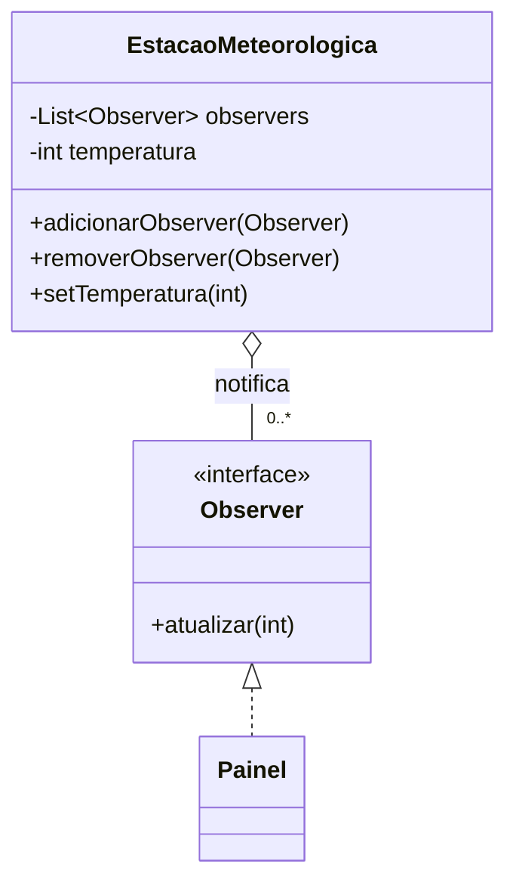

# Observer

## Intenção e exemplo

Observer é um padrão comportamental que define uma dependência um-para-muitos: quando o sujeito muda, seus observadores inscritos são notificados.

No exemplo, `EstacaoMeteorologica` notifica painéis quando a temperatura muda. Observadores podem entrar ou sair da lista durante a execução.

## Características

- o sujeito mantém uma coleção de inscritos;
- observadores compartilham um contrato de atualização;
- a notificação normalmente ocorre após uma mudança relevante;
- o modelo pode usar envio de dados (*push*) ou consulta posterior (*pull*). O exemplo usa *push*.

## Recursos de POO utilizados

- **Interface e abstração:** `Observer` define como receber atualizações.
- **Polimorfismo:** o sujeito notifica objetos diferentes pela mesma operação.
- **Agregação:** a estação mantém uma lista de observadores com ciclos de vida independentes.
- **Encapsulamento:** somente a estação controla quando uma mudança gera notificação.
- **Baixo acoplamento:** o sujeito conhece o contrato, não as classes concretas.

## Vantagens

- permite adicionar assinantes sem alterar o sujeito;
- mantém componentes fracamente acoplados;
- suporta eventos e atualização de várias visualizações;
- inscrições podem mudar em tempo de execução.

## Desvantagens

- ordem das notificações pode não ser garantida;
- observadores lentos atrasam uma notificação síncrona;
- esquecer de remover inscritos pode reter objetos na memória;
- cascatas de eventos podem ser difíceis de depurar.

## Diagrama de classes



## Executar

```bash
javac -d out src/Main.java
java -cp out Main
```
