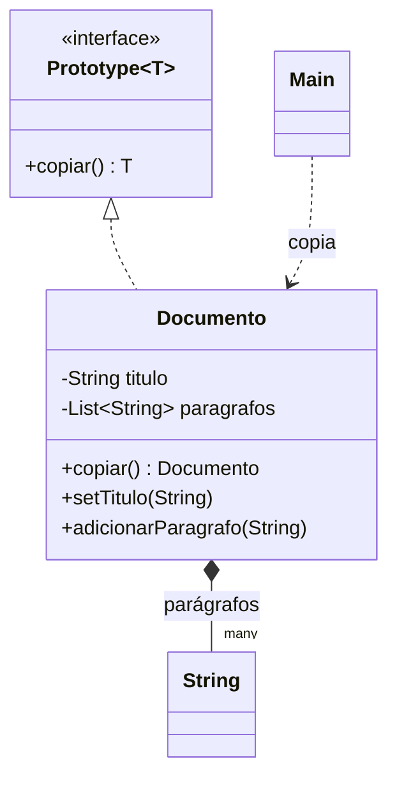

# Prototype

## Intenção e exemplo

Prototype é um padrão criacional que produz novos objetos copiando um objeto existente, chamado protótipo. É útil quando a configuração inicial é custosa ou quando o código cliente não deve depender da classe concreta criada.

No exemplo, `Documento.copiar()` usa um construtor de cópia. A lista de parágrafos também é copiada, portanto alterar a cópia não modifica o original.

## Características

- cria objetos por clonagem, não pela repetição manual da configuração;
- cada protótipo controla como sua cópia é realizada;
- exige decidir entre cópia rasa e cópia profunda;
- pode manter protótipos previamente configurados em um catálogo.

## Recursos de POO utilizados

- **Interface e abstração:** `Prototype<T>` declara o contrato de cópia sem expor sua implementação.
- **Polimorfismo:** diferentes classes podem implementar `copiar()` de formas próprias.
- **Encapsulamento:** `Documento` conhece seus campos e é responsável por copiá-los corretamente.
- **Composição:** a lista contida no documento também precisa ser tratada durante a cópia.
- **Construtor de cópia:** técnica usada para produzir uma cópia profunda da coleção.

## Vantagens

- evita repetir configurações complexas;
- reduz a dependência de construtores concretos;
- pode tornar a criação de objetos caros mais eficiente;
- permite criar variações a partir de um modelo pronto.

## Desvantagens

- copiar grafos com referências circulares pode ser difícil;
- uma cópia rasa pode compartilhar estado mutável por engano;
- toda alteração nos campos exige revisar a lógica de cópia;
- o método `Object.clone()` de Java tem uma API problemática, por isso o exemplo usa um contrato próprio.

## Diagrama de classes



## Executar

```bash
javac -d out src/Main.java
java -cp out Main
```
