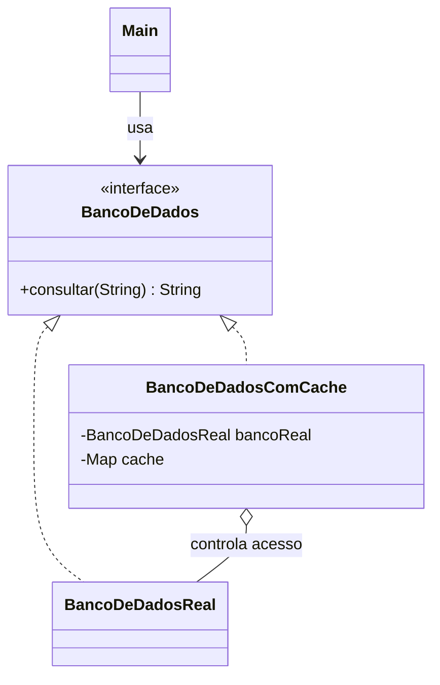

# Proxy

## Intenção e exemplo

Proxy é um padrão estrutural que fornece um substituto com a mesma interface de um objeto real e controla o acesso a esse objeto.

No exemplo, `BancoDeDadosComCache` ocupa o lugar de `BancoDeDadosReal`. Ele cria o objeto real somente quando necessário e guarda resultados de consultas repetidas.

## Características

- proxy e objeto real implementam o mesmo contrato;
- o cliente pode usar o proxy de forma transparente;
- o proxy controla quando e como a chamada chega ao objeto real;
- variações comuns: proxy virtual, remoto, de proteção, cache e registro.

## Recursos de POO utilizados

- **Interface e polimorfismo:** proxy e objeto real são substituíveis como `BancoDeDados`.
- **Composição:** o proxy mantém a referência do objeto real.
- **Delegação:** quando não há resposta no cache, a chamada é encaminhada.
- **Encapsulamento:** cache e inicialização tardia ficam ocultos do cliente.
- **Substituição:** o cliente depende do contrato e não precisa saber qual implementação recebeu.

## Vantagens

- adiciona controle de acesso sem alterar o objeto real;
- permite inicialização tardia de objetos caros;
- pode implementar cache, segurança, auditoria ou acesso remoto;
- preserva a interface original para o cliente.

## Desvantagens

- adiciona indireção e complexidade;
- pode aumentar a latência;
- cache exige políticas de expiração/invalidação em sistemas reais;
- falhas do objeto remoto ou real podem ficar menos evidentes ao cliente.

## Diagrama de classes



## Executar

```bash
javac -d out src/Main.java
java -cp out Main
```
