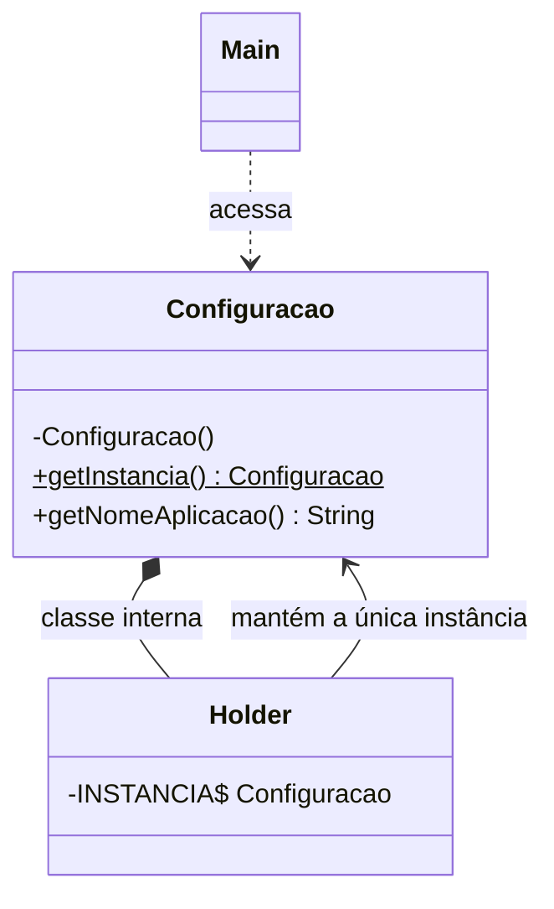

# Singleton

## Intenção e exemplo

Singleton é um padrão criacional que garante uma única instância de uma classe e oferece um ponto global de acesso a ela.

No exemplo, `Configuracao` usa a técnica *Initialization-on-demand holder idiom*. A JVM inicializa `Holder.INSTANCIA` somente no primeiro acesso e garante a segurança entre threads durante a inicialização da classe.

## Características

- construtor privado impede instanciação externa;
- método estático devolve sempre a mesma referência;
- a instância é criada sob demanda;
- a classe é `final` para impedir subclasses que contornem a singularidade.

## Recursos de POO utilizados

- **Encapsulamento:** o construtor e a referência única ficam escondidos.
- **Controle de instanciação:** a própria classe determina quando e como nasce sua instância.
- **Membro estático:** o ponto de acesso pertence à classe, e não a um objeto.
- **Identidade de objeto:** todas as chamadas retornam a mesma identidade, verificada com `==`.
- **Imutabilidade/finalização:** `final` ajuda a preservar a garantia do padrão.

## Vantagens

- garante uma única instância;
- fornece acesso centralizado;
- permite inicialização tardia;
- pode ser adequado para um recurso realmente único no processo.

## Desvantagens

- introduz estado global e dependências ocultas;
- dificulta testes isolados e substituição por objetos falsos;
- pode acumular responsabilidades demais;
- em aplicações distribuídas, garante uma instância apenas por class loader/JVM, não em todo o sistema;
- serialização e reflexão exigem cuidados adicionais em cenários avançados.

## Diagrama de classes



## Executar

```bash
javac -d out src/Main.java
java -cp out Main
```
