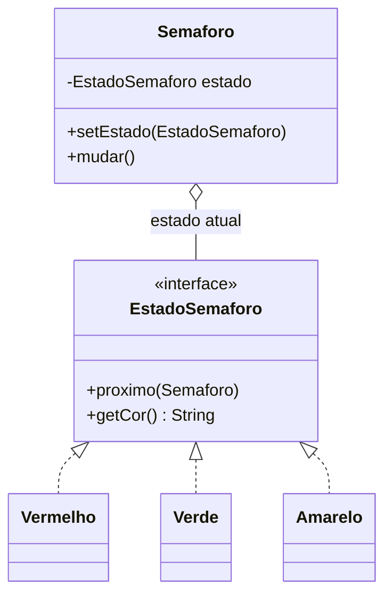

# State

## Intenção e exemplo

State é um padrão comportamental que permite a um objeto alterar seu comportamento quando seu estado interno muda. Cada estado é representado por um objeto próprio.

No exemplo, `Semaforo` delega a transição ao estado atual. `Vermelho`, `Verde` e `Amarelo` conhecem a próxima transição, evitando condicionais repetidas no contexto.

## Características

- cada estado concreto encapsula comportamentos e transições;
- o contexto mantém uma referência para o estado atual;
- trocar o objeto de estado muda o comportamento do contexto;
- substitui condicionais extensas baseadas em códigos de estado.

## Recursos de POO utilizados

- **Interface e abstração:** `EstadoSemaforo` define as operações válidas em qualquer estado.
- **Polimorfismo:** `proximo()` executa uma lógica diferente conforme o objeto atual.
- **Composição:** `Semaforo` contém seu estado atual.
- **Delegação:** o contexto encaminha a ação ao estado.
- **Encapsulamento:** regras e transições de cada estado ficam em sua classe.

## Vantagens

- elimina ou reduz grandes blocos `if/else` e `switch`;
- localiza o comportamento de cada estado;
- facilita adicionar estados;
- torna as transições mais explícitas e testáveis.

## Desvantagens

- aumenta o número de classes;
- pode ser exagero para poucos estados estáveis;
- transições distribuídas podem dificultar uma visão global do fluxo;
- estados que criam novos objetos a cada transição podem exigir otimização em casos intensivos.

## Diagrama de classes



## Executar

```bash
javac -d out src/Main.java
java -cp out Main
```
