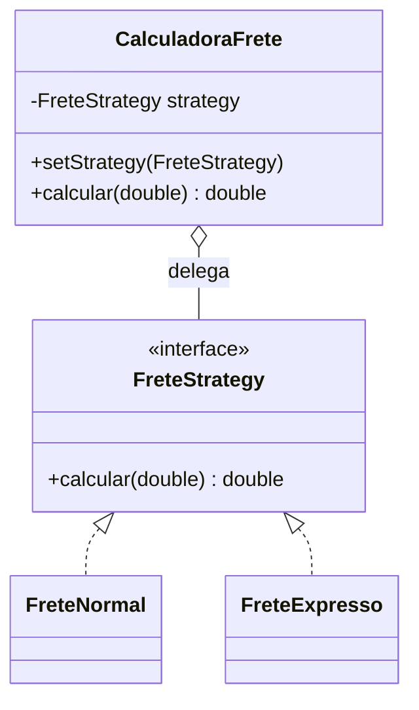

# Strategy

## Intenção e exemplo

Strategy é um padrão comportamental que define uma família de algoritmos, encapsula cada um deles e permite substituí-los durante a execução.

No exemplo, `CalculadoraFrete` delega o cálculo para a estratégia escolhida. É possível trocar de frete normal para expresso sem alterar a calculadora.

## Características

- algoritmos intercambiáveis compartilham a mesma interface;
- o contexto recebe ou configura uma estratégia;
- cada estratégia concentra uma variação do algoritmo;
- substitui condicionais usadas apenas para escolher uma regra.

## Recursos de POO utilizados

- **Interface e abstração:** `FreteStrategy` representa a família de algoritmos.
- **Polimorfismo:** `calcular()` assume comportamentos diferentes conforme a estratégia.
- **Composição:** `CalculadoraFrete` possui uma estratégia.
- **Delegação:** o contexto encaminha o cálculo ao objeto configurado.
- **Encapsulamento:** a fórmula de cada modalidade fica isolada.

## Vantagens

- troca algoritmos em tempo de execução;
- elimina condicionais extensas;
- facilita testes unitários de cada regra;
- permite adicionar estratégias sem mudar o contexto.

## Desvantagens

- aumenta o número de classes ou objetos;
- o cliente precisa conhecer as opções para escolher uma;
- estratégias muito simples podem gerar abstração excessiva;
- todos os algoritmos precisam se ajustar a um contrato comum.

## Diagrama de classes



## Executar

```bash
javac -d out src/Main.java
java -cp out Main
```
