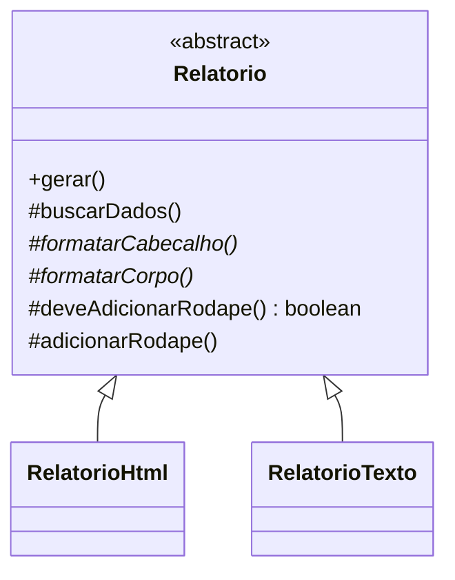

# Template Method

## Intenção e exemplo

Template Method é um padrão comportamental que define o esqueleto de um algoritmo na superclasse e permite que subclasses personalizem etapas específicas sem alterar a ordem geral.

No exemplo, `Relatorio.gerar()` fixa a sequência. Relatórios HTML e texto implementam cabeçalho e corpo. O método `deveAdicionarRodape()` é um *hook* opcional.

## Características

- o método template organiza e chama as etapas;
- etapas comuns possuem implementação na superclasse;
- etapas obrigatórias podem ser abstratas;
- *hooks* oferecem pontos opcionais de extensão;
- o método template costuma ser `final` para preservar a sequência.

## Recursos de POO utilizados

- **Herança:** subclasses reutilizam a estrutura definida por `Relatorio`.
- **Polimorfismo:** etapas abstratas executam a implementação da subclasse.
- **Abstração:** a superclasse representa o processo geral sem conhecer todos os detalhes.
- **Encapsulamento algorítmico:** a ordem das etapas fica centralizada em `gerar()`.
- **Sobrescrita:** subclasses personalizam operações primitivas e *hooks*.

## Vantagens

- elimina duplicação em algoritmos parecidos;
- preserva uma sequência obrigatória;
- fornece pontos de extensão controlados;
- concentra o comportamento invariável na superclasse.

## Desvantagens

- depende de herança, criando acoplamento com a superclasse;
- muitas etapas e *hooks* podem dificultar o entendimento;
- uma mudança no template afeta todas as subclasses;
- pode violar substituição se subclasses quebrarem expectativas das etapas.

## Diagrama de classes



## Executar

```bash
javac -d out src/Main.java
java -cp out Main
```
